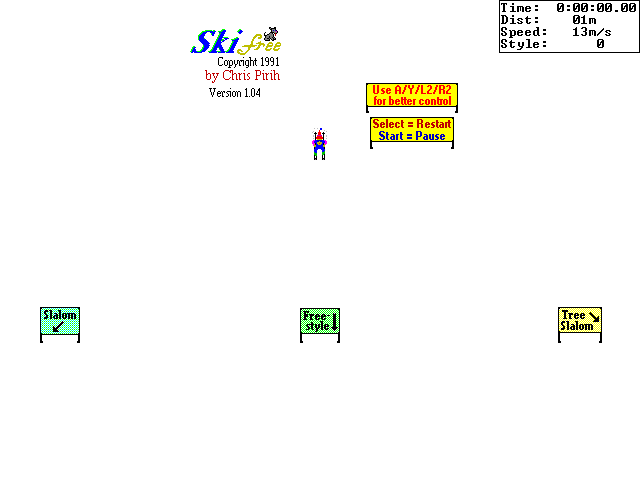

# SkiFree — Miyoo Mini Plus / OnionOS Port

An unofficial port of the classic Windows game **SkiFree** (Chris Pirih, 1991) to run as a
standalone OnionOS Port on the **Miyoo Mini Plus**, based on the open-source decompilation of the
original game and its SDL2 source port.

<p align="center">
  
</p>

This port belongs to the same series as
[fallout1-ce-miyoomini](https://github.com/cacuracaptors/fallout1-ce-miyoomini),
[fallout2-ce-miyoomini](https://github.com/cacuracaptors/fallout2-ce-miyoomini),
[spacecadetpinball-miyoomini](https://github.com/cacuracaptors/spacecadetpinball-miyoomini) and
[OpenLara-miyoomini](https://github.com/cacuracaptors/OpenLara-miyoomini).

Built on top of the [SkiFree decompilation](https://github.com/yuv422/skifree_decomp) by Eric Fry,
its SDL2 source port by [jeff-1amstudios](https://github.com/jeff-1amstudios/skifree_sdl) and
[Slayer366](https://github.com/Slayer366/skifree_sdl), and the SDL2 port for this hardware by
[steward-fu](https://github.com/steward-fu/sdl2).

## Ready to run

Nothing else to download: the game's graphics are built into the program, as in the
[PortMaster](https://portmaster.games/detail.html?name=skifree) version of this same source port.
SkiFree has always been given away for free by its author, on its
[official site](https://ski.ihoc.net/).

## Features

- **60 frames per second**, with the game running at exactly the original speed: the game logic
  still runs on the original 40 ms tick, and the picture is drawn 60 times a second in between.
  Menu+Start switches back to the original 25 frames per second (see [Frame rate](#frame-rate))
- **Light on the battery**: the program sleeps until the next frame, instead of drawing the screen
  over and over
- Pixel-perfect 640×480 picture, one game pixel per screen pixel
- The status box (Time, Dist, Speed, Style) in the original Windows "Terminal" font
- **High Scores**, as in the original (the 10 best results of each course), now with your name,
  typed with the buttons (see [High Scores](#high-scores))
- The signs on the title screen name the Miyoo buttons
- Silent, like the original game
- The Menu key quits when **released**, and only if no other button was pressed while it was held,
  so Menu+Start, Menu+Select and the OnionOS Menu+Power screenshot combo don't quit the game

## Controls

The same layout as the PortMaster version, with Menu to quit, Start to pause and Select for a new
game.

| Button              | Action                                  |
| ------------------- | --------------------------------------- |
| D-pad               | Move (as with the keyboard arrow keys)  |
| A                   | Immediate down-right                    |
| Y                   | Immediate down-left                     |
| L2                  | Immediate left-face                     |
| R2                  | Immediate right-face                    |
| B / R1              | Jump                                    |
| X                   | Slight jump                             |
| L1                  | Speed boost (on / off)                  |
| Start               | Pause / Resume                          |
| Select              | New game                                |
| Menu key (Function) | Exit the game                           |
| Menu + Start        | Frame rate: 60 fps / original (25 fps)  |
| Menu + Select       | High Scores                             |

Holding the D-pad repeats the move with the timings of a Windows keyboard, as on PC.

## High Scores

The original game keeps the 10 best results of each of its three courses (the time for Slalom and
Tree Slalom, the style points for Freestyle) and shows them in a "High Scores" box when you reach
the finish line: your result is marked "<-- that's you", or shown below the list with
"<-- try again!". This port does the same, and adds your name to each result.

- When a run makes the top 10, the box opens by itself so you can type your name, the same way as
  in the other ports of this series:
  - **D-pad Up/Down**: choose the letter (shown inverted)
  - **D-pad Left**: switch between upper and lower case
  - **D-pad Right**: add a space
  - **A**: keep the letter and move to the next one
  - **B**: erase
  - **Start**: save
- Saving an empty name uses the last name you typed ("Skier" at first).
- Press **Menu+Select** at any time to see the tables. **D-pad Left/Right** switches between the
  courses, **Select** asks whether to clear the table on the screen (**A**: yes, **B**: no), and
  **A**, **B**, **Start** or **Y** close the box.
- The game is paused while the box is open, and the Menu key does nothing, so the OnionOS
  Menu+Power screenshot combo works on it.
- Your scores are saved as soon as you save a name, in `Roms/PORTS/Games/SkiFree/highscores.txt`.
  Keep that file when you update or reinstall the port (extracting a new version's zip over the
  old one keeps it).

## Frame rate

The original game updates and draws the slope 25 times a second (every 40 ms). This port keeps the
game running at that same rate, so speed, physics and the timer are exactly the original's, but
draws the picture 60 times a second: between two updates, everything on screen is drawn part of
the way from where it was to where it is now. The slope scrolls smoothly instead of in steps.

**Menu+Start** switches between this (the default) and the original 25 frames per second, which
uses a little less battery. The choice is saved in `Roms/PORTS/Games/SkiFree/framerate.cfg`.

## Installation

1. Download the latest `.zip` from the [Releases](https://github.com/cacuracaptors/skifree-miyoomini/releases)
   tab of this repository.
2. Extract its contents to the root of your OnionOS SD card.
3. On the device, open the **Ports** menu — "SkiFree" should appear in the list. If not, use
   "refresh roms" at the bottom of the list.

## Known issues

- The decompilation's conversion to C is not byte-exact, so small differences from the Windows
  game may remain.
- Where the original showed an "Assertion Failed" box (an internal check of the game that went
  wrong), this port writes it to `Roms/PORTS/Games/SkiFree/log.txt` and pauses the game, as
  pressing OK did in the original; press Start to carry on. Earlier SDL builds closed the game at
  that point.

## Changelog

- **v1.0.0** — Initial release.

## Building from source

This port requires cross-compiling for ARMv7 hard-float using a Docker-based toolchain. Tested on
Windows + WSL2 + Docker Desktop.

### Prerequisites

- WSL2 with Ubuntu, and Docker Desktop with WSL integration enabled.

### Steps

```
mkdir -p ~/skifree-miyoo && cd ~/skifree-miyoo

# Cross toolchain
git clone https://github.com/shauninman/union-miyoomini-toolchain.git

# SDL2 ported for the Miyoo Mini (Plus)
git clone https://github.com/steward-fu/sdl2.git sdl2-miyoo

# This repository
git clone https://github.com/cacuracaptors/skifree-miyoomini.git skifree_sdl

# The game's graphics, extracted from the original SKI32.EXE (not stored in git)
cd skifree_sdl
curl -Lo /tmp/ski32_resources.zip https://archive.org/download/ski32_resources/ski32_resources.zip
unzip -d resources /tmp/ski32_resources.zip
```

**1) Build the Miyoo Mini SDL2** (inside `sdl2-miyoo`, via Docker — see the
[steward-fu/sdl2](https://github.com/steward-fu/sdl2) instructions for the full
`make cfg && make gpu && make sdl2` process).

**2) Build SkiFree** inside the toolchain container, with this folder as the workspace:

```
cd ~/skifree-miyoo/union-miyoomini-toolchain
make shell
```

Inside the container:

```
cd ~/workspace/skifree_sdl
./build_miyoomini.sh
```

The script expects `sdl2-miyoo` next to `skifree_sdl` in the workspace; other locations can be
given with `WS=...`, `SDL2_DIR=...` and `CMAKE=...` (any CMake, it is only used to embed the
graphics). The result is in `build-miyoo/package/Roms/`.

**3) Make the release zip** (outside the container). The game also needs the SDL2 libraries:
`libSDL2-2.0.so.0` from the `sdl2-miyoo` build and its dependencies `libEGL.so`, `libGLESv2.so`
and `libjson-c.so.5` — the same files shipped with the other ports of this series, so they can be
taken from one of their release zips (or from a folder holding the four files):

```
python3 make_release.py 1.0.0 /path/to/Pinball-Miyoo-v1.3.0.zip
```

This writes `SkiFree-Miyoo-v1.0.0.zip`.

The PC build of the upstream project (`CMakeLists.txt`, `build.sh`) still works and now only needs
SDL2.

### What this fork changes (compared to Slayer366/skifree_sdl)

- **`src/skifree_decomp.c`**
  - **Controls**: the Miyoo buttons are mapped onto the original keyboard keys and mouse click
    (`miyooMapKey()`), in the PortMaster port's layout; the Menu key and its combos are read in the
    main loop, and `/dev/input` is also read while Menu is held, since Power and the volume keys
    never reach SDL on this device. Held keys repeat with the Windows keyboard timings. Leftover
    Windows key codes in the key handler (which, as SDL keys, made letters like "a" turn the
    skier) are removed.
  - **Main loop**: instead of drawing the screen in a busy loop, the program sleeps until the next
    40 ms game tick, as the original's `SetTimer` did, which is much lighter on the battery.
  - **60 fps**: each object's position relative to the skier is kept at every tick, and frames
    are drawn 60 times a second in between (`interpSnapshot()`, `interpOffset()`); larger jumps,
    like a new game, are not smoothed. Menu+Start switches back to one frame per tick.
  - **Drawing**: this device's SDL2 renderer limits textures to 640×480 and the sprite sheets are
    taller, so the whole frame is drawn into a 640×480 surface (`screenSurface`) and sent to the
    screen in one piece; the sprite sheets stay surfaces, with white as the transparent colour.
  - **Text**: the status box and the port's boxes use the Windows "Terminal" OEM font
    (`src/oemfont.h`, generated from `resources/vgaoem.fon`) instead of SDL2_ttf; the bitmaps are
    loaded with `SDL_LoadBMP` instead of SDL2_image.
  - **High Scores**: `updateEntPackIniKeyValue()`, empty in the decompilation (the original wrote
    `ENTPACK.INI` and showed a message box), now keeps the tables in `highscores.txt` and shows
    them in a box drawn by the port, with name entry.
  - **No sound**, as in the original: the sound effects added by the SDL port, and SDL2_mixer, are
    removed.
  - Every game is different again: the random generator is seeded from the clock, as the original
    did with `GetTickCount()` (the SDL port always used the same seed).
  - An internal check that fails is logged and pauses the game, as in the original, instead of
    closing it. A "Ski Paused" box replaces the window title the original used.
- **`miyoo/ski32_55.bmp`, `miyoo/ski32_56.bmp`** — the two signs on the title screen ("Use A/Y/L2/R2
  for better control", "Select = Restart / Start = Pause"), made from the original signs with the
  same letters; the build uses them in place of the originals.
- **`build_miyoomini.sh`**, **`make_release.py`**, **`miyoo/`** — the Miyoo build, the release zip,
  and the files shipped with the game: the OnionOS shortcut (`SkiFree.port`), its image
  (`SkiFree.png`), the launcher (which writes `log.txt`) and `README.txt`.

## Credits

- Chris Pirih — the original SkiFree (1991)
- [Eric Fry (yuv422)](https://github.com/yuv422/skifree_decomp) — the SkiFree decompilation
- [jeff-1amstudios](https://github.com/jeff-1amstudios/skifree_sdl), brooksytech and
  [Slayer366](https://github.com/Slayer366/skifree_sdl) — the SDL2 source port
- [steward-fu](https://github.com/steward-fu) — SDL2 for the Miyoo Mini (Plus)
- [shauninman](https://github.com/shauninman) — union-miyoomini-toolchain

## License

The decompilation and the SDL2 source port this fork is based on don't state a license, and this
fork doesn't add one either. SkiFree and its graphics are by Chris Pirih.
